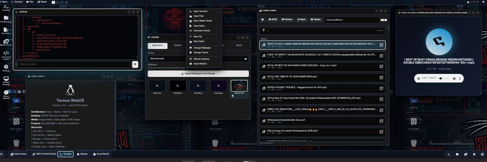
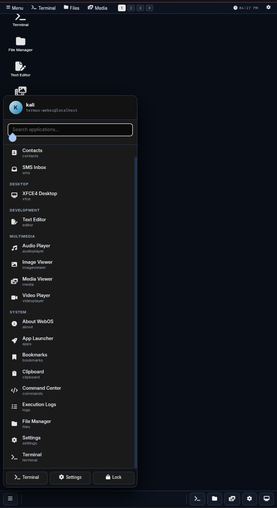
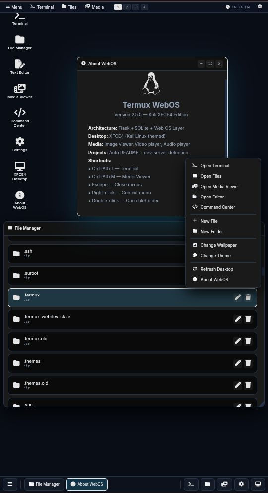
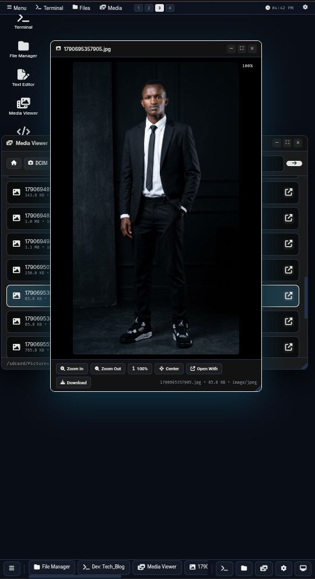
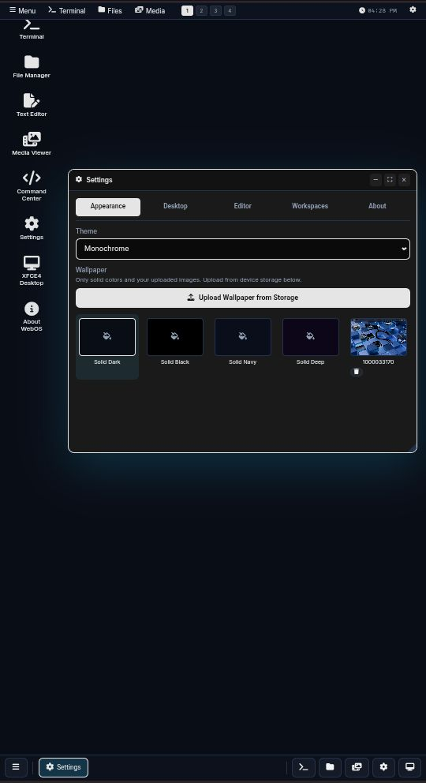
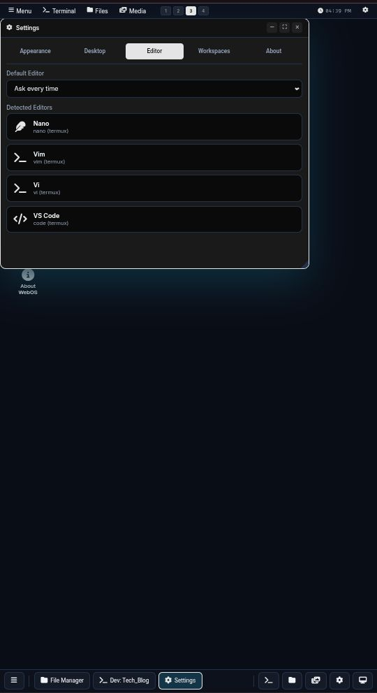
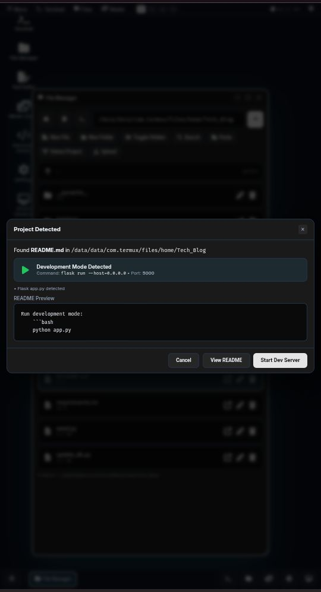
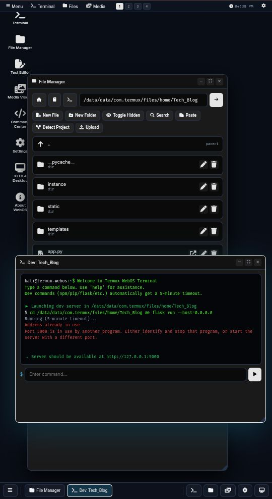
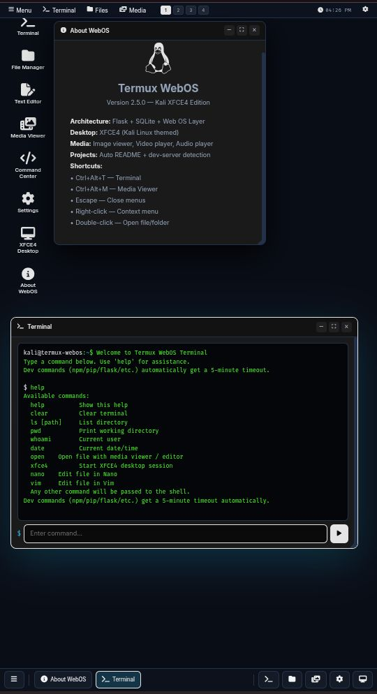
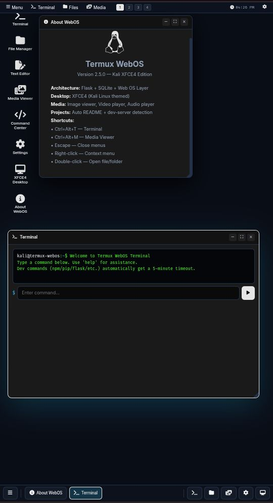

<div align="center">


# 🐧 Termux WebOS

### A full desktop-class WebOS experience for Termux — Kali Linux XFCE4 themed

*Turn your Android device into a portable Linux workstation with a browser-based desktop environment, file manager, media viewers, text editors, and native Termux integration.*

[Features](#-features) • [Screenshots](#-screenshots) • [Installation](#-installation) • [Usage](#-usage) • [API Reference](#-api-reference) • [Architecture](#-architecture) • [Contributing](#-contributing)

</div>

---

## 📖 Overview

**Termux WebOS** is a self-hosted, browser-based desktop environment built on top of Flask and Termux. It brings a complete OS-like experience — windowed apps, a taskbar, a start menu, workspaces, and persistent window states — directly to your Android device through a single `python server.py` command.

Designed with **Kali Linux / XFCE4** aesthetics in mind, it integrates natively with the Termux API, allowing you to send SMS, make calls, take photos, list contacts, and run shell commands — all from a beautiful, responsive web UI.

---

## ✨ Features

### 🖥️ Desktop Environment
- **Windowed application manager** with drag, resize, minimize, maximize, and close
- **Persistent window state** — positions, sizes, and states are restored on next launch
- **Multi-workspace support** with a visual workspace indicator
- **Start menu** with searchable, categorized application launcher
- **Taskbar** with live task switching and quick-launch buttons
- **Top bar** with workspace switcher, live clock, and system menu
- **Right-click context menu** on the desktop
- **Keyboard shortcuts** (Ctrl+Alt+T for terminal, Ctrl+Alt+M for media viewer)

### 🎨 Theming & Appearance
- **8 built-in themes**: Kali Dark, Kali Blue, Matrix Green, Blood Red, Royal Purple, Amber, Cyberpunk, Monochrome
- **Solid-color wallpapers** for performance (no external URL dependencies)
- **Custom wallpaper upload** from device storage (up to 8MB)
- **Live theme switching** with instant CSS variable updates

### 📁 File Manager
- Full CRUD operations (create, read, update, delete)
- Rename, copy, cut, paste, move with a visual clipboard
- Recursive directory search
- Rich file metadata (permissions, size, timestamps, MIME type)
- File info dialog with preview support
- Toggle hidden files
- Multi-select and context menu per file
- **Direct file upload** from your device storage

### 🎬 Media Viewers
| Viewer | Capabilities |
|--------|-------------|
| **Image Viewer** | Zoom (10%–800%), pan, center, download, open-with |
| **Video Player** | Native HTML5 controls, ±10s skip, HTTP range streaming (seek support) |
| **Audio Player** | Spinning disc animation, native controls, metadata display |
| **Media Hub** | Browse DCIM, Pictures, Music, Movies folders with quick shortcuts |

### 📝 Editors
- **Built-in GUI editor** with line/col status, tab insertion, wrap toggle, save-as
- **Terminal editors** (Nano, Vim, Vi, Neovim) with in-browser simulation
- **Editor auto-detection** — the app detects which editors are installed
- **Default editor preference** to skip the "Open With" dialog
- **Recent files** tracking

### 🚀 Project Development Mode
- **Auto README detection** — scans for `README.md`, `readme.md`, `README.txt`, etc.
- **Automatic dev-command detection** for:
  - Node.js (`package.json` → `npm run dev` / `npm start`)
  - Python (`app.py`, `manage.py`, `main.py` → Flask, Django, FastAPI)
  - Go (`go.mod` → `go run .`)
  - Rust (`Cargo.toml` → `cargo run`)
  - Docker (`docker-compose.yml`)
- **Port auto-detection** from scripts and configs
- **One-click dev server launch** with a **5-minute timeout** for long-running commands
- **README preview** in a modal dialog

### 📱 Termux API Integration
- SMS send / list
- Contact list with quick call & message actions
- Battery status, WiFi info, location
- Camera photo capture
- Text-to-speech
- Notifications and toasts
- Vibration, telephony calls
- Android app launching via package name

### 🧠 System Apps
- **Terminal** — full shell with dev-command timeout extension
- **Command Center** — preset commands, all-binary browser, custom shell runner
- **Execution Logs** — SQLite-backed log of every command with status
- **App Launcher** — quick access to all registered apps
- **Bookmarks** — save favorite paths
- **Clipboard Manager** — persistent clipboard history
- **XFCE4 Desktop** — launch XFCE4 session and components (thunar, mousepad, xfce4-terminal, etc.)

---

## 📸 Screenshots

> All screenshots captured on Termux / Android with Chrome.

### Desktop & Start Menu
<p align="center">
  
  
</p>

### File Manager & Media Viewer
<p align="center">
  
  
</p>

### Settings — Appearance & Wallpaper Upload
<p align="center">
  
  
</p>

### Project Detection & Dev Server
<p align="center">
  
  
</p>

### Terminal & About
<p align="center">
  
  
</p>

---

## 🛠️ Installation

### Prerequisites

- **Termux** (from [F-Droid](https://f-droid.org/en/packages/com.termux/) — the Play Store version is deprecated)
- **Termux:API** companion app (also from F-Droid)
- Python 3.9+ (installed below)

### Step 1 — Update Termux

```bash
pkg update && pkg upgrade -y
```

Step 2 — Install dependencies

```bash
pkg install -y python termux-api git nano vim
```

For media playback in the browser, no additional packages are required — modern mobile browsers handle HTML5 video/audio natively.

Step 3 — Grant Termux API permissions

```bash
termux-setup-storage
```

Then go to Android Settings → Apps → Termux:API → Permissions and grant:

· Contacts
· SMS
· Phone
· Storage
· Camera
· Location

Disable battery optimization for Termux and Termux:API.

Step 4 — Clone or download the project

```bash
cd ~
git clone https://github.com/redirect-param/termux-webos.git
cd termux-webos
```

Or simply download termuxOS-v2.5.0.py into a folder.

Step 5 — Run

```bash
python server.py
```

You should see:

```
============================================================
  Termux WebOS — Kali XFCE4 Edition v2.5.0
============================================================
  Access: http://127.0.0.1:5000
  Bind:   0.0.0.0:5000
============================================================
```

Step 6 — Open in your browser

Navigate to:

```
http://127.0.0.1:5000
```

To access from another device on your network:

```
http://<your-phone-ip>:5000
```

Find your IP with:

```bash
ifconfig | grep inet
```

---

🚀 Usage

First Launch

On first boot, the app will:

1. Create termux_gui.db (SQLite database)
2. Register all built-in applications
3. Create 4 default workspaces: Main, Web, Dev, Media
4. Apply the default Kali Dark theme with a solid dark wallpaper

Keyboard Shortcuts

Shortcut Action
Ctrl + Alt + T Open Terminal
Ctrl + Alt + M Open Media Viewer
Esc Close menus / modals
Ctrl + S Save in editor
Ctrl + X Close editor (with save prompt)

Opening Files

From File Manager:

· Single-click a folder to enter it
· Double-click a file to auto-detect its type and open the right viewer
· Right-click for a full context menu (Open With, Rename, Delete, Copy, Cut, Properties, Download)

From Terminal:

```bash
open /sdcard/DCIM/photo.jpg       # opens image viewer
open /sdcard/Movies/video.mp4     # opens video player
open ~/project/README.md          # opens editor chooser
nano ~/project/app.py             # opens terminal editor
```

Project Development Mode

1. Navigate to a project folder in File Manager
2. Click Detect Project in the toolbar
3. If a README.md is found, the dialog will show:
   · The detected dev command (e.g. flask run --host=0.0.0.0)
   · The detected port (e.g. 5000)
   · A README preview
4. Click Start Dev Server to launch it in a new terminal window

Dev commands automatically receive a 5-minute timeout to prevent premature termination.

Wallpaper Customization

1. Open Settings → Appearance
2. Click Upload Wallpaper from Storage
3. Pick an image (max 8MB)
4. The wallpaper is stored as a data URI in SQLite — no external dependencies

---

📡 API Reference

All endpoints accept and return JSON.

Execution

Method Endpoint Description
POST /api/execute Run a shell command

Body: { command, args, timeout?, cwd? }

Filesystem

Method Endpoint Description
POST /api/fs/list List directory contents
POST /api/fs/read Read text file
POST /api/fs/write Write text file
POST /api/fs/create Create file/folder
POST /api/fs/delete Delete file/folder
POST /api/fs/rename Rename/move
POST /api/fs/copy Copy file/folder
POST /api/fs/move Move file/folder
POST /api/fs/search Recursive filename search
POST /api/fs/info Detailed file stats
GET /api/fs/media?path=… Stream media (range requests supported)
POST /api/fs/media_info Media metadata
POST /api/upload Multipart file upload

Project Detection

Method Endpoint Description
POST /api/project/detect Detect README + dev command in a folder
POST /api/project/read_readme Read README contents

Window State Persistence

Method Endpoint Description
GET /api/window_states Get all saved window geometries
POST /api/window_states Save an app's window geometry
DELETE /api/window_states/<app_id> Forget an app's geometry

Wallpapers

Method Endpoint Description
GET /api/wallpapers List solid + custom wallpapers
POST /api/wallpapers/upload Upload a data-URI wallpaper
DELETE /api/wallpapers/<id> Delete a custom wallpaper

Preferences, Apps, Bookmarks

Method Endpoint Description
GET/POST /api/preferences Read/write preferences
GET/POST /api/apps List/register apps
DELETE /api/apps/<app_id> Unregister app
GET/POST /api/bookmarks List/add bookmarks
DELETE /api/bookmarks/<id> Remove bookmark
GET/POST /api/clipboard Clipboard history
DELETE /api/clipboard/<id> Remove clipboard item

System

Method Endpoint Description
GET /api/commands Discovered binaries + editors
GET /api/logs Execution log (last 50)
POST /api/xfce/start Start an XFCE4 session

---

🏗️ Architecture

```
┌──────────────────────────────────────────────────────┐
│                  Browser (Chrome / Firefox)          │
│  ┌──────────────┐  ┌──────────────┐  ┌────────────┐  │
│  │   Desktop    │  │  Start Menu  │  │  Taskbar   │  │
│  │   Windows    │  │              │  │            │  │
│  └──────────────┘  └──────────────┘  └────────────┘  │
└─────────────────────────┬────────────────────────────┘
                          │ HTTP / JSON
                          ▼
┌──────────────────────────────────────────────────────┐
│              Flask Server (server.py)                │
│  ┌────────────────────────────────────────────────┐  │
│  │  API Layer (REST endpoints)                    │  │
│  ├────────────────────────────────────────────────┤  │
│  │  Business Logic                                │  │
│  │  ├── Execution Engine (subprocess)             │  │
│  │  ├── Filesystem Engine (safe_path validation)  │  │
│  │  ├── Media Streaming (send_file w/ range)      │  │
│  │  ├── Project Detector (README + dev commands)  │  │
│  │  └── Window State Persistence                  │  │
│  ├────────────────────────────────────────────────┤  │
│  │  SQLite Persistence (termux_gui.db)            │  │
│  │  ├── execution_logs      ├── bookmarks         │  │
│  │  ├── workspaces          ├── clipboard         │  │
│  │  ├── installed_apps      ├── recent_files      │  │
│  │  ├── preferences         ├── window_states     │  │
│  │  ├── editor_sessions     ├── custom_wallpapers │  │
│  │  └── project_cache                             │  │
│  └────────────────────────────────────────────────┘  │
└─────────────────────────┬────────────────────────────┘
                          │ subprocess
                          ▼
┌──────────────────────────────────────────────────────┐
│  Termux Environment                                  │
│  • /data/data/com.termux/files/usr/bin (Termux bins) │
│  • Kali chroot (optional): /usr/bin/*                │
│  • Android system bins: /system/bin, /system/xbin    │
│  • Termux:API (SMS, Contacts, Camera, etc.)          │
└──────────────────────────────────────────────────────┘
```

Security Model

· Path validation — every filesystem operation is checked against ALLOWED_BASES:
  · ~/ (Termux home)
  · /sdcard and /storage/emulated/0
  · /data/data/com.termux/files
  · /tmp
· Critical path protection — refuses to delete /, /sdcard, $TERMUX_HOME, /data/data/com.termux/files
· Binary file detection — files containing \x00 bytes are flagged as binary and blocked from the text editor
· Size limits — 5MB read cap for text files, 8MB for uploaded wallpapers

---

🧰 Tech Stack

Layer Technology
Backend Python 3, Flask
Database SQLite 3
Frontend Vanilla JS (no framework), HTML5, CSS3
Icons Font Awesome 6
Fonts Inter, Fira Code
Media HTML5 , <video>, <audio>
Persistence SQLite (12 tables)
Integration Termux:API, Kali chroot (optional)

---

📂 Project Structure

```
termux-webos/
├── server.py                 # Main Flask app (single-file)
├── termux_gui.db             # SQLite database (created on first run)
├── README.md
├── LICENSE
├── docs/
│   └── screenshots/
│       ├── desktop.png
│       ├── start-menu.png
│       ├── file-manager.png
│       ├── image-viewer.png
│       ├── settings-appearance.png
│       ├── settings-editor.png
│       ├── project-detected.png
│       ├── dev-server.png
│       ├── terminal.png
│       └── about.png
└── uploads/                  # Uploaded files (created on first run)
```

---

🔧 Configuration

Preferences are stored in the preferences table and can be updated via Settings or the API:

Key Default Description
theme kali-dark Active theme ID
wallpaper solid-dark Active wallpaper ID
default_editor ask Default editor (ask for chooser)
confirm_delete true Confirm before deletion
show_hidden_files false Show dotfiles
editor_wrap true Word wrap in GUI editor
restore_window_state true Persist window geometry
window_animations true Enable open/close animations

---

🐛 Troubleshooting

Port 5000 already in use

```bash
# Find the process
lsof -i :5000
# Or change the port in server.py
```

Edit the last line of server.py:

```python
app.run(host="0.0.0.0", port=8080, debug=False, threaded=True)
```

Termux:API commands return nothing

1. Ensure both Termux and Termux:API are installed from F-Droid
2. Run termux-setup-storage
3. Grant permissions in Android Settings → Apps → Termux:API
4. Disable battery optimization for both apps

Media files don't play

· Ensure the browser supports the codec (Chrome supports most)
· Check the file isn't corrupted
· Large videos may take a moment to buffer — range requests are supported

Dev server times out

· The 5-minute timeout is intentional to prevent zombie processes
· For longer-running servers, run them manually in Termux, then access via the browser

---

🤝 Contributing

Contributions are welcome! Please follow these steps:

1. Fork the repository
2. Create a branch: git checkout -b feature/amazing-feature
3. Commit your changes: git commit -m 'Add amazing feature'
4. Push: git push origin feature/amazing-feature
5. Open a Pull Request

Guidelines

· Keep the single-file architecture (server.py) unless refactoring is explicitly discussed
· Maintain backward compatibility — do not remove existing endpoints or preferences
· Test on real Termux / Android before submitting
· Update this README if you add user-facing features

---

📜 License

This project is licensed under the MIT License — see the LICENSE file for details.

---

🙏 Acknowledgements

· Termux — the amazing Android terminal emulator
· Kali Linux — for the XFCE4 aesthetic inspiration
· Flask — the lightweight WSGI framework
· Font Awesome — icons
· Inter & Fira Code — typography

---

⭐ Star History

If you find this project useful, please consider giving it a ⭐ on GitHub — it helps others discover it!

<div align="center">

Made with ❤️ for the Termux community

⬆ Back to top

</div>
